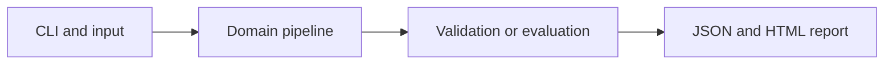

# Donor-Held-Out Single-Cell Annotation

Classify fictional cell populations from gene-count profiles while keeping held-out donors out of training.

**Category:** Biology / ML

**Execution:** Actual local algorithm or workflow; no external model service required.

## Run

```sh
python -m venv .venv
# Windows: .venv\Scripts\activate
# macOS/Linux: source .venv/bin/activate
python -m pip install -r requirements.txt
python app.py
python -m unittest discover -v
```

Open `results/report.html` after running. Python 3.10+ is required. Use `--help` for input and seed options.

## Architecture



## Algorithm

Simulate count data with three marker programs and donor-specific variation. Normalize each cell by library size, apply log1p, fit scaling on training donors and learn a multiclass softmax classifier.

## Evaluation

Hold out donors 6 and 7 entirely. Report accuracy and macro F1 against a training-majority baseline; save donor identities and predictions to audit the split.

## Limitations

Cell labels, genes and counts are synthetic. This is not UCE or a biological foundation model; real donor and platform shifts can be much larger.

## Documentation

- [PDF project guide](PROJECT_GUIDE.pdf)
- [Editable guide](GUIDE.md)
- [Model and system card](MODEL_CARD.md)
- [Measured results](results/metrics.json)
- [Test output](TEST_RESULTS.txt)

## Extend it

Use a licensed annotated single-cell dataset, preserve donor-level splitting, add unknown-cell rejection and compare a pretrained cell representation.

AI-assisted educational project with synthetic data. Review, customize and explain your own contribution accurately. MIT license.

## Biology scope and current relevance

Default inputs are synthetic or project-authored. No clinical deployment or wet-lab validation is claimed. See [research context](RESEARCH_CONTEXT.md) and [data provenance](DATA_PROVENANCE.md).

- [Universal cell embedding provides a foundation model for cell biology](https://www.nature.com/articles/s41586-026-10689-z) (2026)
